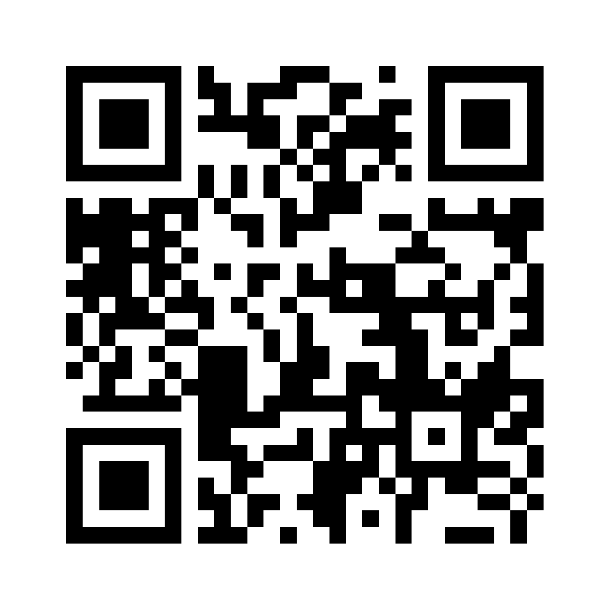
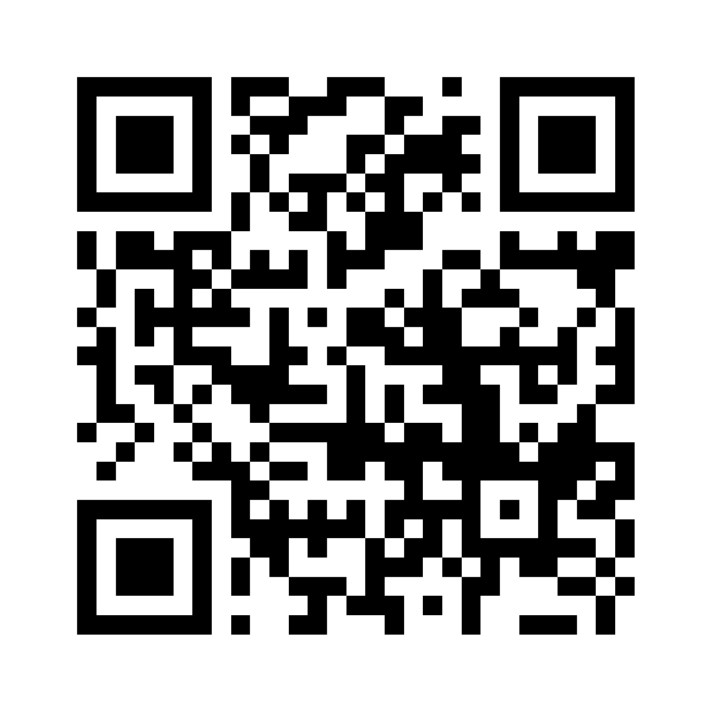
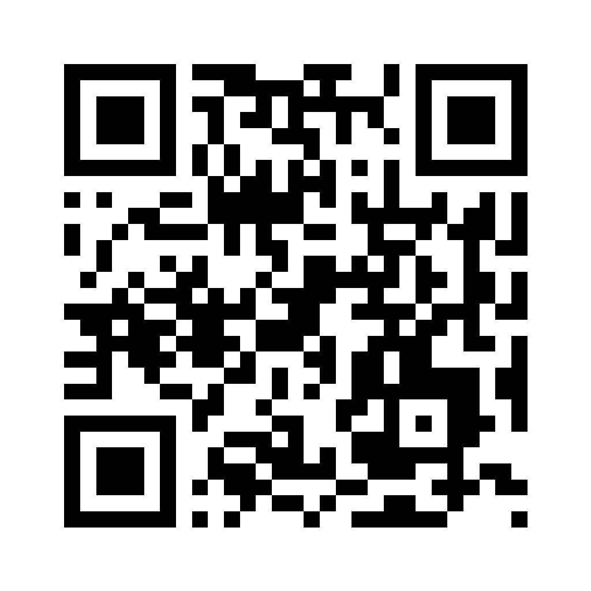
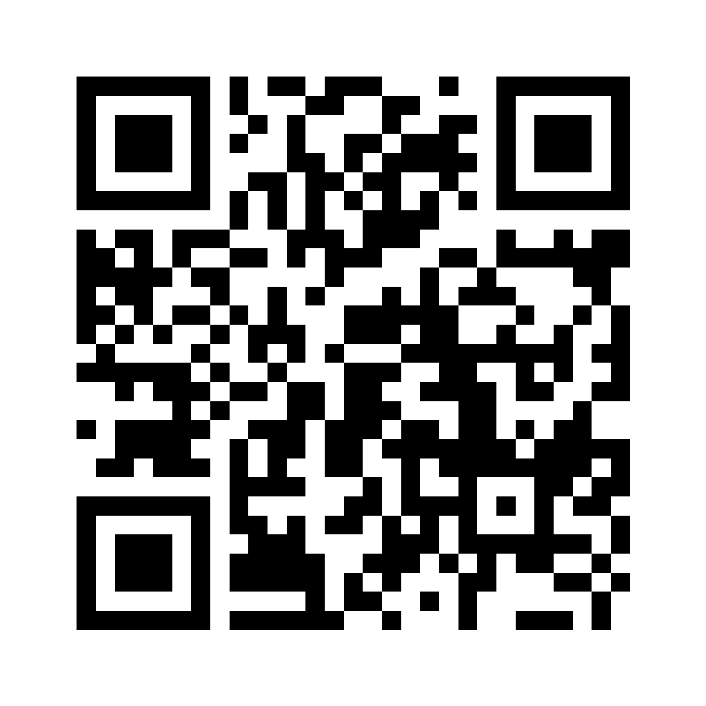
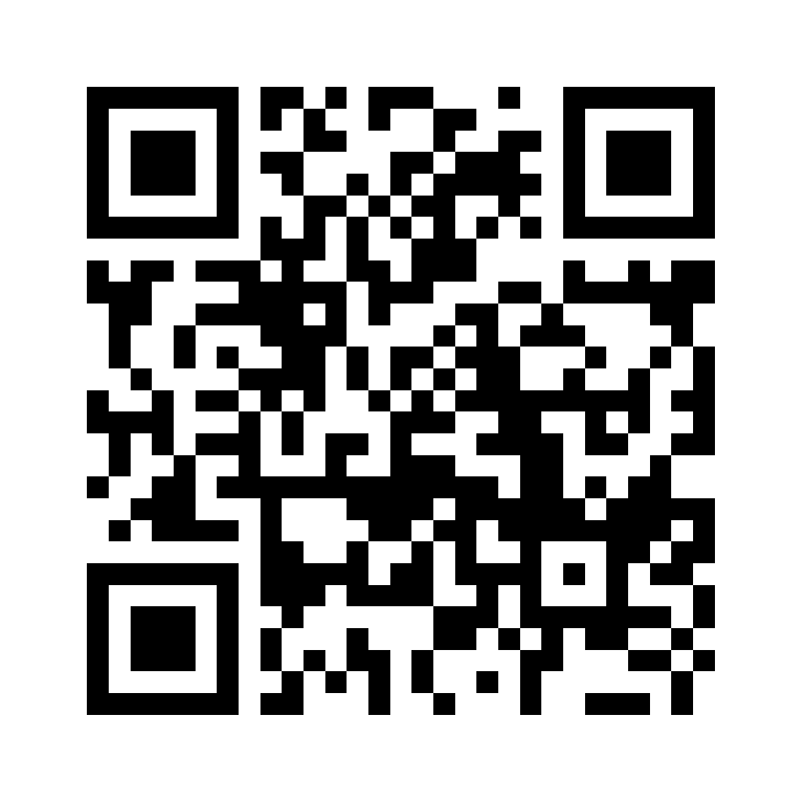
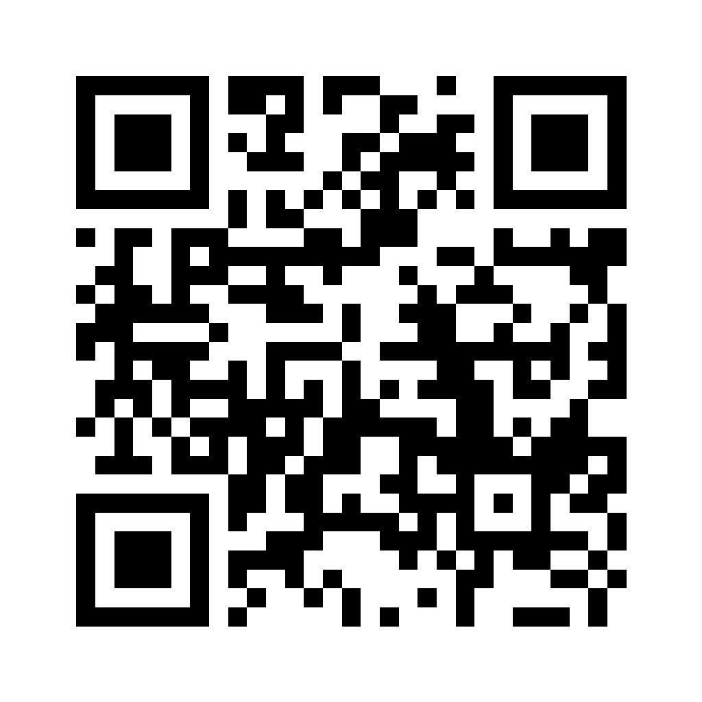
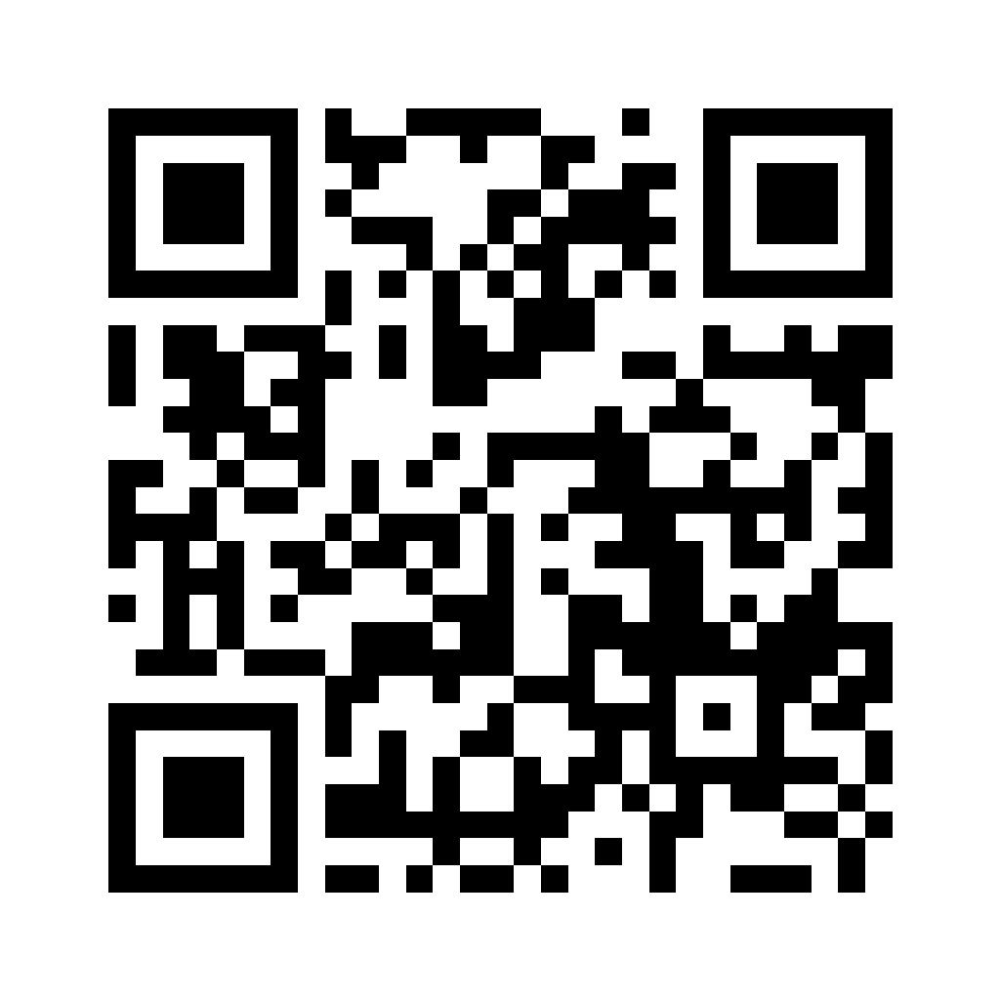

# Quest QR codes («Chłodne hasło»)

One code per quest place, in quest order. Print each one (at least 8 cm wide) and hang it at the public entrance of the place. The app accepts a scan only within 150 m of the place, once a day per player.

Generated by `node tools/qr/generate.mjs --png docs/quest-qr` from the codes in Firestore `questCodes` (see docs/dev.md). The letters are not printed: they would give the password away.

> These images are public in this repository, so anyone can scan them without visiting. Before the quest goes live for real users, rotate the codes (`node tools/firestore-seed/seed.mjs --new-codes …`) and print the new ones from the PDF instead.

| # | Place | Id | QR |
| --: | --- | --- | --- |
| 1 | Manufaktura | `cool-002` |  |
| 2 | Biblioteka Wolność (Biblioteka Miejska, filia nr 39) | `cool-007` |  |
| 3 | Mediateka MeMo (Biblioteka Miejska, filia nr 29) | `cool-006` |  |
| 4 | Park im. S. Staszica | `cool-017` |  |
| 5 | Dworzec Łódź Fabryczna | `cool-005` |  |
| 6 | EC1 Łódź – Miasto Kultury | `cool-001` |  |
| 7 | Galeria Łódzka | `cool-003` |  |
