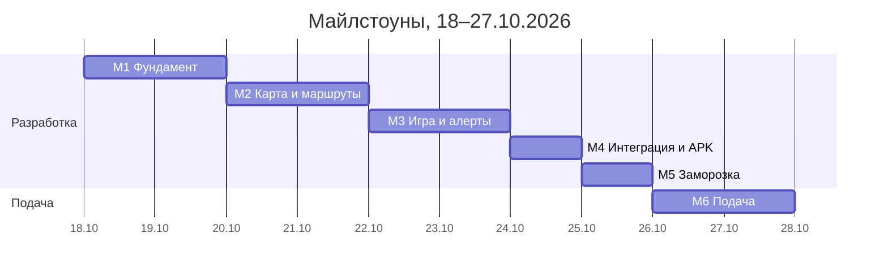

# Cool Łódź: спецификация мобильного приложения

Oct 18, 2026 · @Mikita

> Копия спецификации в репозитории: на её разделы ссылаются issues. Две встроенные схемы исходного документа заменены: карта экранов — ссылкой на Figma, майлстоуны — диаграммой.

Это полный пакет спецификации приложения Cool Łódź (часть B брифа) для агента-исполнителя: по нему делается макет в Figma, заводятся задачи в GitHub и стартует разработка. Источник требований — бриф «Cool Łódź: brief techniczny» v0.1 от 18.10.2026; где спецификация с ним расходится, верна спецификация. Как агенту работать с документом, написано в последнем разделе.

## Допущения

На приложение у нас около 40 часов на двоих: 2 человека × \~2,5 часа × 8 дней (18–25.10), 26–27.10 только подача и видео. Этого хватает на ядро, если остальное вынести в kolejne kroki.

- **Владельцы:** MD — Mikita Dzeviatau, AH — Artem Hnap.
- **Данные:** почти всё реальное, поэтому отдельные пометки «dane symulowane» не делаем. Единственное, что в демо условно, — коды скидок MPK: это одна строка в документации, а не метка в интерфейсе.
- **Страховка:** в приложении есть demo-режим с сохранёнными JSON для двух референсных маршрутов. Если API модуля D недоступен, приложение всё равно показывает маршруты.
- **Оценки** даны с учётом Claude Code. Если задача выходит больше чем в 1,5 раза от оценки, режем её, а не сдвигаем остальное.
- **Внутренний дедлайн:** 25.10 заморозка, 26.10 вечером всё готово, 27.10 до 12:00 подача.

## Продукт

Cool Łódź — Android-приложение, которое в жару строит пешие маршруты по Лодзи через тень, зелень и тихие улицы, показывает miejsca chłodu и воду и превращает их посещение в игру. Конкурс: Hackathon Future Smart City 2026, область Health Shift, команда Better Than Never.

**Задача пользователя:** дойти из точки A в точку B в жаркий день, проведя на солнце как можно меньше времени, и знать, где можно остыть и попить воды.

**Целевые пользователи:**

| Сегмент | Что им нужно от приложения |
| --- | --- |
| Сеньоры (65+) | Максимум тени, лавки и места отдыха на маршруте, крупный шрифт, простой интерфейс |
| Туристы | Маршрут между достопримечательностями в тени, кондиционированные места рядом |
| Родители с коляской | Без лестниц, тень, лавки |
| Жители (работа, учёба, прогулка) | Компромисс между временем и тенью, алерты о жаре |
| Владельцы собак | Тень, зелень, вода |

**Язык интерфейса:** польский (основной). Английский — вне объёма, но все строки сразу выносим в ARB-файлы (`intl`), чтобы перевод был дешёвым.

**Объём (MoSCoW):**

| Функция | Приоритет | Комментарий |
| --- | --- | --- |
| Онбординг, вход по e-mail, согласия | M | Без входа через соцсети |
| Выбор профиля комфорта | M | Рабочих профилей 3: Senior, Turysta, Domyślny. Остальные 5 из брифа только в документации |
| Карта с фильтрами (тень, зелень, вода, miejsca chłodu, воздух, тишина) | M | Слои с API модуля D |
| Планирование маршрута A→B, дата и время | M |  |
| Результат: 3 варианта (najkrótsza, zacieniona, kompromis) | M | Сравнение по времени, длине, доле тени |
| Miejsca chłodu: список, «otwarte teraz», «Prowadź tam» | M |  |
| Квест с QR и буквами | M |  |
| Значки и очки | M | Минимум 3 значка работают в демо |
| Рейтинг районов и пользователей | M |  |
| Push-алерт о жаре и «режим жары» | M | Для демо достаточно тестового push |
| Настройки, приватность, удаление аккаунта | M |  |
| Ползунок «лучшее время выхода» на результате маршрута | S | Тень уже посчитана по 30-минутным интервалам |
| Zgłoszenia (тип проблемы + GPS, без фото) | S |  |
| Навигация шаг за шагом | вне объёма | kolejne kroki |
| Оценка маршрута после прогулки | вне объёма | kolejne kroki |
| AI-ассистент | вне объёма | kolejne kroki |
| Фото в zgłoszeniach, групповые прогулки, реферальный код | вне объёма | kolejne kroki |
| iOS | вне объёма | Без Android остаётся сайт |

## Архитектура и стек

Приложение не считает тень само: маршруты, слои карты и места приходят из общего API модуля D, а аккаунт, игра и рейтинг живут в Firebase.

| Слой | Решение | Почему |
| --- | --- | --- |
| Фреймворк | Flutter (stable), Dart 3, только Android, minSdk 24 | Опыт команды с прошлого года |
| Состояние | Riverpod | Простой DI, удобно подменять API на demo-режим |
| Навигация | go\_router, нижняя панель из 4 вкладок |  |
| Карта | flutter\_map + векторные/растровые тайлы провайдера с бесплатным планом, атрибуция OSM | Не используем tile.openstreetmap.org в продакшене |
| Слои карты | GeoJSON из API модуля D | Тот же источник, что у сайта |
| Аккаунт | Firebase Auth, e-mail и пароль |  |
| Данные игры | Cloud Firestore, регион europe-central2 (Варшава) | RODO, данные в ЕС |
| Push | Firebase Cloud Messaging | Отправка тестового алерта из консоли Firebase |
| QR | mobile\_scanner |  |
| Геолокация | geolocator, только во время использования |  |
| HTTP | dio + json\_serializable | Модели строятся из контракта API |
| Локальный кэш | shared\_preferences или hive | Последний маршрут и список miejsc chłodu без сети |
| Cloud Functions | не используем | Нужен тариф Blaze; проверки делаем правилами Firestore |

**Demo-режим.** Класс `ApiClient` имеет две реализации: `RemoteApiClient` (реальный модуль D) и `DemoApiClient` (JSON из `assets/demo/`). Переключатель скрыт в настройках (5 нажатий на версию приложения). Если удалённый API не отвечает за 8 секунд, приложение показывает данные из demo и баннер «Brak połączenia z serwerem, pokazujemy ostatnie dane». Это страхует показ жюри 6.11.

**Структура проекта:**

```
lib/
  app/            роутер, тема, локализация
  core/           api (remote + demo), модели, ошибки, геолокация
  features/
    auth/  onboarding/  profile/  map/  route/  cool_places/
    quest/  achievements/  leaderboard/  alerts/  reports/  settings/
  shared/         виджеты дизайн-системы
assets/demo/      JSON по контракту API
```

## Карта экранов

Карта экранов (16 экранов, 4 вкладки) — на странице [Flow в Figma](https://www.figma.com/design/U5IzePCuqa0gZlipjRQEOm/Cool-Lodz-App?node-id=1-5); кликабельный прототип — на странице [Screens](https://www.figma.com/design/U5IzePCuqa0gZlipjRQEOm/Cool-Lodz-App?node-id=1-4).

Выделен S07 «Wynik trasy» — ради него существует приложение, на нём держится демо. Переходы между вкладками (S08 → S07, S16 → S04) подписаны в карточках, а не стрелками.

## Экраны

16 экранов; каждый в Figma рисуется в трёх состояниях, где они есть: данные, загрузка, ошибка или пусто. Нижняя панель: **Mapa**, **Chłód**, **Quest**, **Profil**. Тексты интерфейса ниже даны на польском, как в приложении.

### S01 Onboarding (M)

- 3 слайда: «Idź w cieniu» (маршруты по тени), «Znajdź miejsce chłodu» (места и вода), «Zbieraj litery» (квест и значки). Кнопки «Dalej», «Pomiń».
- Показывается один раз после установки.

### S02 Logowanie i rejestracja (M)

- Вкладки «Zaloguj się» / «Załóż konto»: e-mail, пароль, псевдоним (при регистрации), ссылка «Nie pamiętam hasła».
- Ошибки под полями: неверный пароль, занятый e-mail, нет сети.
- Псевдоним виден в рейтинге; подсказка: «Nie podawaj imienia i nazwiska».

### S03 Zgody (M)

- Три переключателя с пояснением: локализация (обязательно для квеста), уведомления, участие в rankingu. Ссылка на politykę prywatności.
- Кнопка «Akceptuję i dalej»; системные запросы Android показываются после неё.

### S04 Wybór profilu (M)

- Карточки профилей: Senior, Turysta, Domyślny (иконка, 1 строка описания). Остальные профили брифа — неактивные карточки «Wkrótce».
- Под карточкой «Dostosuj»: 4 ползунка (cień, czas, cisza, powietrze) от 0 до 100.
- Профиль Senior включает крупный шрифт (см. «Дизайн-система»).
- Тот же экран открывается из Profil → «Mój profil komfortu».

### S05 Mapa (M, главный экран)

- Карта Лодзи, центр на пользователе или на Śródmieście, если геолокация выключена.
- Сверху поле «Dokąd idziesz?» → открывает S06.
- Ряд чипов-фильтров: Cień, Zieleń, Cisza, Powietrze, Woda, Miejsca chłodu. Активный чип показывает свой слой; одновременно не больше 2 слоёв-заливок (cień, zieleń, cisza, powietrze) плюс любые точки.
- Слой тени: полупрозрачная синяя заливка; над картой подпись времени «Cień o 14:30» и кнопка смены времени.
- Точки: miejsca chłodu (снежинка), вода (капля), лавки (только при зуме ≥ 17).
- Если действует алерт о жаре — сверху баннер «Ostrzeżenie przed upałem, stopień 2» (цвет по степени), нажатие открывает S14.
- Нажатие на точку → нижняя шторка S08.
- Состояния: нет геолокации (кнопка «Włącz lokalizację»), нет сети (demo-баннер).

### S06 Planowanie trasy (M)

- Поля «Skąd» (по умолчанию «Moja lokalizacja») и «Dokąd», поиск по адресам и местам, кнопка поменять местами.
- Дата и время выхода («Teraz» по умолчанию).
- Текущий профиль чипом, нажатие → S04.
- Быстрые варианты: две референсные трассы (Manufaktura → Piotrkowska, Plac Wolności → Piotrkowska) для демо.
- Кнопка «Pokaż trasy».

### S07 Wynik trasy (M)

- Карта с тремя линиями; выбранная яркая, остальные серые. Участки на солнце на выбранной линии — оранжевые, в тени — синие.
- Нижняя шторка с тремя карточками: **Najkrótsza**, **Zacieniona**, **Kompromis**. На карточке: время (мин), длина (км), доля тени (%, крупно, с полоской), «+4 min względem najkrótszej», значки остановок (miejsca chłodu, вода) на пути.
- По умолчанию выбрана Kompromis; для профиля Senior — Zacieniona.
- (S) Ползунок «Najlepsza pora wyjścia»: часы 8:00–20:00, под ним мини-график доли тени выбранного варианта.
- Кнопка «Prowadź» открывает маршрут в Google Maps (навигация вне объёма); кнопка «Zapisz».
- Состояния: загрузка (скелетон карточек), маршрут не найден, вне зоны расчёта тени («Dla tego obszaru cień jest przybliżony»).

### S08 Szczegóły miejsca (M, нижняя шторка)

- Название, тип, адрес, часы работы, статус «Otwarte teraz / Zamknięte, otwarcie o 10:00».
- Иконки удобств: klimatyzacja, woda, toaleta, dostępne dla wózków.
- Если место в квесте — бейдж «Litera do zdobycia».
- Кнопки «Prowadź tam» (→ S07 с этим местом как B) и «Zgłoś problem» (→ S15).

### S09 Miejsca chłodu (M, вкладка Chłód)

- Переключатель «Lista / Mapa». Список отсортирован по расстоянию.
- Фильтры-чипы: Otwarte teraz, Z wodą, Dostępne, W queście.
- Элемент списка: название, тип, расстояние, часы сегодня, статус.
- Пусто: «Brak otwartych miejsc w pobliżu» + кнопка «Pokaż wszystkie».

### S10 Quest (M, вкладка Quest)

- Название квеста «Chłodne hasło», поле из букв: найденные открыты, ненайденные — пустые клетки.
- Прогресс «4 z 7 liter», список мест квеста со статусом (odwiedzone / do odwiedzenia), кнопка «Prowadź tam» у каждого.
- Большая кнопка «Skanuj kod QR» → S11.
- После всех букв — поле ввода hasła, затем экран награды: код скидки и текст про MPK.
- В режиме жары сверху плашка «Dziś odwiedzaj miejsca rano lub wieczorem».
- Внутри вкладки сегменты: Quest, Odznaki (S12), Ranking (S13).

### S11 Skaner QR (M)

- Камера на весь экран с рамкой, подсказка «Zeskanuj kod przy wejściu».
- Успех: анимация открытия буквы, «+50 pkt».
- Ошибки: «Jesteś za daleko od miejsca» (> 150 м), «Ten kod już dziś zeskanowałeś», «Kod nieważny».
- Нет разрешения камеры: пояснение и кнопка «Otwórz ustawienia».

### S12 Odznaki i punkty (M)

- Сетка значков 3 в ряд: полученные цветные, остальные серые с условием получения.
- Сверху сумма очков и последние 10 начислений (что, когда, сколько).
- При получении значка — модальное окно с конфетти.

### S13 Ranking (M)

- Переключатель «Dzielnice / Użytkownicy», период «Ten tydzień / Całe lato».
- Строка: место, название района или псевдоним, очки. Своя строка подсвечена и закреплена снизу, если её нет на экране.

### S14 Alert upałowy i tryb upału (M)

- Push: «Ostrzeżenie przed upałem 2. stopnia w Łodzi do 20:00. Zobacz trasy w cieniu».
- Экран алерта: степень, период, источник (IMGW), 3 короткие рекомендации, ссылка на официальные zalecenia, кнопка «Pokaż miejsca chłodu».
- Режим жары включается при степени 3: задания квеста на солнце скрыты, на карте приоритет miejsc chłodu, баннер на S05 и S10.

### S15 Zgłoszenie (S)

- Тип: brak ławki, brak poidełka, brak cienia, inne. Позиция с GPS на мини-карте (можно сдвинуть), комментарий до 200 знаков.
- После отправки: «Dziękujemy! +20 pkt po zatwierdzeniu».

### S16 Profil i ustawienia (M, вкладка Profil)

- Шапка: псевдоним, район (выбор из 5), сумма очков.
- Пункты: Mój profil komfortu, Powiadomienia, Zgody i prywatność, Polityka prywatności, O aplikacji i źródła danych, Wyloguj, Usuń konto.
- «Usuń konto»: подтверждение с вводом пароля, удаляет пользователя и все его документы.
- «O aplikacji»: версия (5 нажатий → переключатель demo-режима), источники данных и атрибуция OSM.

## Дизайн-система

Основа — Material 3 с собственной палитрой «прохлада против жары»: сине-бирюзовый цвет означает тень и безопасность, оранжевый — солнце и жару. Только светлая тема; тёмная вне объёма. Базовый фрейм в Figma: Android 360 × 800 dp.

**Цвета (токены):**

| Токен | HEX | Где используется |
| --- | --- | --- |
| `primary` / cień | #0E6E8C | Кнопки, активные чипы, тень на маршруте, слой тени (35% прозрачности) |
| `primaryContainer` | #CDEFF7 | Фон выбранной карточки, плашки |
| `green` / zieleń | #2E8B57 | Слой зелени (30%), парки, значки «Łowca parków» |
| `sun` / słońce | #F28C28 | Участки на солнце, иконки жары. Только заливки и линии, не текст на белом |
| `water` | #2F80ED | Точки воды |
| `cool` | #5BC0EB | Точки miejsc chłodu |
| `heat1` | #F2C230 | Алерт 1-й степени |
| `heat2` | #F28C28 | Алерт 2-й степени |
| `heat3` | #D7263D | Алерт 3-й степени, режим жары |
| `background` | #F7FAFB | Фон экранов |
| `surface` | #FFFFFF | Карточки, шторки |
| `surfaceVariant` | #EAF1F3 | Неактивные чипы, разделители |
| `onSurface` | #12232B | Основной текст |
| `onSurfaceVariant` | #4A5D66 | Вторичный текст |
| `muted` | #9AA9B0 | Невыбранные маршруты, заблокированные значки |
| `error` | #B3261E | Ошибки |
| `success` | #1E8E3E | Успех, «Otwarte teraz» |

Слой качества воздуха использует официальную шкалу цветов индекса GIOŚ (взять с powietrze.gios.gov.pl), слой тишины — фиолетовую тепловую карту.

**Шрифт:** Inter (Google Fonts, полная поддержка польских букв).

| Стиль | Размер / межстрочный, sp | Начертание |
| --- | --- | --- |
| Display | 32 / 40 | Bold — доля тени на карточке маршрута |
| Title L | 24 / 32 | SemiBold — заголовки экранов |
| Title M | 20 / 28 | SemiBold — заголовки шторок и карточек |
| Body | 16 / 24 | Regular |
| Body S | 14 / 20 | Regular — вторичный текст |
| Label | 12 / 16 | Medium — чипы, подписи |

**Отступы и формы:** сетка 4 dp (4, 8, 12, 16, 24, 32); поля экрана 16 dp; радиусы: чипы 8, карточки 12, шторки 20 (верхние углы); кнопки высотой 52 dp, радиус 12; зона нажатия не меньше 48 × 48 dp.

**Режим Senior** (включается профилем, можно отдельно в настройках): все стили шрифта × 1,25, кнопки 60 dp, меньше элементов на экране (на S07 одна карточка видна целиком, остальные листаются), подписи у всех иконок.

**Линии маршрута:** выбранный вариант 6 dp, участки в тени `primary`, на солнце `sun`; невыбранные 4 dp `muted`.

**Иконки:** Material Symbols Rounded. Своих иконок 3: miejsce chłodu (снежинка в домике), poidełko (капля с краном), litera questu. Логотип — заглушка, финальный делает команда в Gemini.

**Компоненты для Figma (с вариантами):**

- Button: primary, secondary, text; обычный и Senior.
- FilterChip: выкл, вкл; с иконкой слоя.
- SearchField «Dokąd idziesz?».
- RouteVariantCard: najkrótsza, zacieniona, kompromis; выбранная и нет; с полоской ShadeBar.
- ShadeBar: горизонтальная полоса доли тени с числом в %.
- HeatBanner: степени 1, 2, 3.
- PlaceListItem и PlaceSheet: открыто, закрыто, в квесте.
- LetterTile: найдена, пустая.
- BadgeTile: получен, заблокирован.
- LeaderboardRow: обычная, своя.
- BottomNav: 4 вкладки, активная и нет.
- EmptyState, ErrorState, Skeleton, Toast, модальное окно значка.

**Доступность:** контраст текста не ниже WCAG AA (4,5:1); цвет никогда не единственный носитель смысла (рядом с цветом тени всегда число в %); подписи для TalkBack; приложение уважает системный размер шрифта.

**Тон текстов:** на «ty», коротко и спокойно, без запугивания и медицинских обещаний. В «O aplikacji» строка: «Aplikacja nie jest wyrobem medycznym. W razie złego samopoczucia dzwoń 112».

## Геймификация

Игра награждает прогулки в тени и визиты в miejsca chłodu утром и вечером, а не выход в самую жару. Числа ниже — стартовые значения; команда может их менять, они хранятся в одном файле конфигурации `game_config.dart`.

**Квест «Chłodne hasło»:**

1. 7 мест квеста (из списка miejsc chłodu, см. «Данные»), у каждого QR-код и одна буква. Пример hasła: CHŁODNO.
2. QR содержит ссылку `coollodz://quest/{placeId}?c={kod}`.
3. Скан засчитывается, если: код совпадает с кодом места в Firestore (проверяют правила доступа), пользователь не дальше 150 м от места (проверка в приложении), это первый скан этого места сегодня (id документа `{uid}_{placeId}_{yyyyMMdd}`, перезапись запрещена правилами).
4. После 7 букв пользователь вводит hasło и получает код скидки. В демо код условный, реальная интеграция с MigAppka MPK — в kolejne kroki.
5. Коды мест можно менять вручную в Firestore (например раз в неделю), чтобы старая фотография QR переставала работать.

**Очки:**

| Действие | Очки | Ограничение |
| --- | --- | --- |
| Скан QR в miejscu chłodu | 50 | 1 раз в сутки на место |
| Маршрут с долей тени ≥ 60% | 10 | Не больше 5 в сутки; в режиме жары 0, если выход между 11:00 и 17:00 |
| Hasło квеста разгадано | 200 | 1 раз |
| Получен значок | 30 | 1 раз за значок |
| Zgłoszenie подтверждено (S) | 20 | Подтверждение вручную в консоли Firebase |

**Значки** (в демо обязательно работают первые четыре):

| Значок | Условие |
| --- | --- |
| Pierwszy krok | Первый построенный маршрут |
| Cienista dziesiątka | 10 маршрутов с долей тени ≥ 60% |
| Strażnik chłodu | 5 разных miejsc chłodu отсканировано |
| Ranny ptaszek | Маршрут с выходом 6:00–10:00 в день алерта о жаре |
| Wieczorny spacerowicz | Маршрут с выходом 19:00–22:00 в день алерта о жаре |
| Łowca parków | 5 маршрутов с конечной точкой в парке |
| Pomocnik miasta (S) | 3 подтверждённых zgłoszenia |

Ambasador (реферальный код) и Wspólny spacer — kolejne kroki.

**Рейтинг:** 5 районов (Bałuty, Górna, Polesie, Śródmieście, Widzew; подтверждается, см. «Открытые вопросы»). Пользователь выбирает район в профиле, его очки идут и в личный рейтинг, и в рейтинг района. Периоды: текущая неделя (по ISO-неделе) и всё лето. В рейтинге виден только псевдоним.

**Правило безопасности (алерт 3-й степени):**

- задания и очки за маршруты с выходом 11:00–17:00 отключены;
- квест показывает подсказку «Odwiedzaj miejsca rano lub wieczorem», сами miejsca chłodu остаются доступны как укрытие;
- на S05, S10 и S14 баннер со ссылкой на официальные zalecenia.

**Известное ограничение:** без Cloud Functions очки начисляет клиент, а правила Firestore только ограничивают величину прибавки. Для конкурса это допустимо; в kolejne kroki — серверная проверка.

## Данные

Геоданные (маршруты, места, слои, алерты) приложение берёт из API модуля D; аккаунт, игру и рейтинг — из Firestore. Эндпоинты `/v1/quests` и `/v1/leaderboard` из брифа приложение не использует: игра живёт в Firestore.

**Эндпоинты модуля D (контракт из раздела 6 брифа):**

| Эндпоинт | Экраны | Примечание |
| --- | --- | --- |
| `POST /v1/routes` | S06, S07 | Вход: `from`, `to`, `datetime`, `profile` (id + веса), `filters`. Выход: 3 варианта |
| `GET /v1/places?type=cool,water,bench&bbox=` | S05, S08, S09, S10 | Нужны поля `hours`, `amenities`, `accessible`, `questPlace` |
| `GET /v1/alerts?lat&lon` | S05, S14 |  |
| `GET /v1/air?bbox` | S05 (слой Powietrze) |  |
| `GET /v1/layers/{shade,green,noise}?bbox&datetime` | S05 | **Нового эндпоинта нет в брифе**, его нужно запросить у модуля D (GeoJSON или URL тайлов) |
| `POST /v1/reports` | S15 | Альтернатива — запись прямо в Firestore `reports` |

Пример одного варианта маршрута (структура фиксируется в `core/models`):

```json
{
  "variant": "shaded",
  "geometry": {"type": "LineString", "coordinates": [[19.4466, 51.7794], [19.4570, 51.7720]]},
  "segments": [{"from": 0, "to": 12, "sunShare": 0.15}],
  "distance_m": 2140,
  "duration_s": 1680,
  "sunShare": 0.28,
  "extraTimeVsShortest_s": 240,
  "stops": [{"placeId": "cool-017", "type": "cool"}],
  "sunShareByHour": {"08:00": 0.12, "08:30": 0.15}
}
```

Поле `segments` нужно для раскраски линии «тень / солнце» на S07, `sunShareByHour` — для ползунка лучшего времени. Оба поля нужно согласовать с модулем D.

**Firestore (регион europe-central2):**

| Коллекция | Поля | Доступ |
| --- | --- | --- |
| `users/{uid}` | `nickname`, `district`, `profile` {`id`, `weights`, `seniorMode`}, `consents` {`location`, `push`, `ranking`, `acceptedAt`}, `points`, `badges[]`, `fcmToken`, `createdAt` | Читать и писать только владелец; `points` растёт не больше чем на 200 за запись |
| `users/{uid}/pointsLog/{id}` | `type`, `points`, `refId`, `createdAt` | Только владелец, только создание |
| `users/{uid}/routes/{id}` | `from`, `to`, `departAt`, `variant`, `sunShare`, `distance_m`, `endPlaceType`, `createdAt` | Только владелец; нужно для значков |
| `visits/{uid_placeId_yyyyMMdd}` | `uid`, `placeId`, `code`, `lat`, `lon`, `createdAt` | Только создание; `code` должен совпасть с `questCodes/{placeId}` |
| `questPlaces/{placeId}` | `name`, `letter`, `order`, `lat`, `lon` | Чтение всем вошедшим |
| `questCodes/{placeId}` | `code` | Клиент не читает; используется только в правилах |
| `districts/{id}` и `districts/{id}/weeks/{yyyy-Www}` | `name`, `points` | Чтение всем; прибавка не больше 200 за запись |
| `reports/{id}` | `uid`, `type`, `lat`, `lon`, `comment`, `status` (new, approved, rejected), `createdAt` | Создаёт автор; статус меняет только админ |
| `config/game` | `heatOverride` (0–3), `activeQuestId` | Чтение всем; позволяет включить режим жары на демо |

Рейтинг пользователей: запрос `users` с `consents.ranking == true`, сортировка по `points`, первые 50 (нужен составной индекс).

**Demo JSON** (`assets/demo/`), все по контракту API:

- `routes_manufaktura_piotrkowska.json`, `routes_plac_wolnosci_piotrkowska.json` — по 3 варианта, на нескольких временах выхода;
- `places_cool.json` (собранный вручную список, см. бэклог), `places_water.json`, `places_bench.json`;
- `alerts_none.json`, `alerts_level2.json`, `alerts_level3.json`;
- `layer_shade_1430.geojson`, `layer_green.geojson`, `layer_noise.geojson`, `air.json` — для Śródmieścia.

## Нефункциональные требования

| Область | Требование |
| --- | --- |
| Приватность (RODO) | Минимум данных: e-mail, псевдоним, район, настройки профиля. Никаких данных о здоровье: профиль — это предпочтения маршрута. Геолокация только во время использования, трек прогулки не сохраняется. Удаление аккаунта удаляет все документы пользователя. Polityka prywatności доступна из S03 и S16 |
| Ключи | В приложении нет ключей внешних провайдеров. Конфигурация Firebase — обычный `google-services.json` |
| Производительность | Холодный старт до 3 с на среднем Android; ответ на маршрут показывается до 5 с, иначе скелетон и через 8 с переход на demo-данные |
| Офлайн | Последний маршрут и список miejsc chłodu доступны без сети |
| Устройства | Android 7.0+ (minSdk 24), экраны от 360 dp по ширине, только портретная ориентация |
| Сборка | Release APK, подписанный ключом команды (ключ не в репозитории), `versionName` 1.0.0. Публикация: GitHub Releases + ссылка на сайте `/pobierz` и в заявке |
| Качество | `flutter analyze` без ошибок; unit-тесты для правил игры (очки, значки, режим жары) и парсинга моделей API |
| Лицензии | Атрибуция OpenStreetMap на карте и в «O aplikacji»; список источников данных там же |
| Использование AI | Ведём короткий журнал: какие задачи сделаны с Claude Code. Передаётся Mikicie Kutsence для документации (требование регламента) |

## Майлстоуны



Майлстоун считается пройденным, когда выполнено условие ниже; если нет — на следующий день сначала режем S-задачи. Финал 6.11 в 10:00, к нему приложение должно работать и в demo-режиме.

- **M1 Фундамент (19.10):** приложение собирается, вход работает, demo JSON и список miejsc chłodu в репозитории, макет Figma просмотрен.
- **M2 Карта и маршруты (21.10):** на demo-данных проходит путь S05 → S06 → S07 с тремя вариантами; от модуля D пришёл первый реальный маршрут.
- **M3 Игра и алерты (23.10):** скан QR открывает букву, 4 значка открываются, push приходит, режим жары включается из `config/game`.
- **M4 Интеграция и APK (24.10):** референсные трассы с реального API, подписанный APK в GitHub Release.
- **M5 Заморозка (25.10):** чек-лист DoD пройден на двух телефонах, скриншоты сданы; дальше только исправления критических ошибок.
- **M6 Подача (26–27.10):** видео и материалы у Mikity K., заявка на ChallengeRocket отправлена 27.10 до 12:00 (формальный срок 23:59).

## Бэклог задач (issues для GitHub)

Задачи с приоритетом M дают около 46 часов при бюджете около 45 (2 человека × 2,5 ч × 9 дней), запаса нет. Поэтому S-задачи и видео делаем только при опережении графика; если 22.10 отстаём больше чем на 3 часа, первым убираем периоды рейтинга (оставляем только «całe lato»), затем рейтинг районов.

Одна строка = один issue. Заголовок issue = «ID: задача», описание = ссылка на раздел спецификации + колонка «Готово, когда» как чек-лист.

| ID | Задача | Влад. | Майлстоун | Ч | Лейблы | Готово, когда |
| --- | --- | --- | --- | --- | --- | --- |
| APP-00 | Макет в Figma по разделам «Экраны» и «Дизайн-система» | агент, ревью MD+AH | M1 | — | design | 16 экранов, компоненты и токены в Figma; команда оставила комментарии |
| APP-01 | Каркас Flutter: структура, go\_router, Riverpod, тема из токенов, локализация PL | MD | M1 | 1,5 | infra, prio:M | Приложение запускается, 4 вкладки переключаются, цвета и шрифт из токенов |
| APP-02 | Firebase: проект в europe-central2, Auth e-mail, Firestore, FCM | MD | M1 | 1,5 | infra, prio:M | Регистрация создаёт пользователя; тестовый push доходит до телефона |
| APP-03 | Модели API, RemoteApiClient, DemoApiClient, переключатель и fallback 8 с | AH | M1 | 2,5 | infra, area:api, prio:M | Обе реализации проходят unit-тест на одном и том же JSON |
| APP-04 | Demo JSON: 2 референсные трассы, алерты, слои Śródmieścia | AH | M1 | 1 | data, prio:M | Файлы в `assets/demo/` валидны по моделям |
| APP-05 | Ручной список 15–20 miejsc chłodu в Łodzi: адрес, часы летом, удобства, источник; 7 из них для квеста | AH | M1 | 3 | data, prio:M | JSON передан модулю D и лежит в demo; у каждого места ссылка на источник часов |
| APP-06 | Базовые компоненты дизайн-системы (список в «Дизайн-система») | AH | M2 | 1,5 | ui, prio:M | Компоненты в `shared/`, страница-витрина в debug-сборке |
| APP-07 | S01–S03: онбординг, вход и регистрация, согласия | MD | M1 | 2 | area:auth, prio:M | Новый пользователь проходит путь до карты; ошибки входа показываются |
| APP-08 | S04: выбор профиля, ползунки, режим Senior | MD | M2 | 1,5 | area:profile, prio:M | Профиль сохраняется в `users/{uid}`; Senior увеличивает шрифт в 1,25 раза |
| APP-09 | S05: карта, чипы-фильтры, слои, точки, баннер алерта | AH | M2 | 3 | area:map, prio:M | Все 6 фильтров переключают слои на demo-данных |
| APP-10 | S06: планирование маршрута, поиск, время выхода, быстрые трассы | MD | M2 | 1,5 | area:route, prio:M | Запрос уходит с профилем и временем |
| APP-11 | S07: 3 варианта, раскраска тень/солнце, сравнение, «Prowadź» | MD | M2 | 2,5 | area:route, prio:M | Референсная трасса показывает 3 варианта; смена профиля меняет вариант по умолчанию |
| APP-12 | S08 шторка места и S09 список miejsc chłodu с фильтрами | AH | M2 | 2 | area:places, prio:M | «Otwarte teraz» считается по часам; «Prowadź tam» открывает S07 |
| APP-13 | Схема Firestore, правила доступа, индексы, `config/game` | AH | M3 | 1,5 | infra, area:game, prio:M | Тест правил: повторный скан за день и чужой документ отклоняются |
| APP-14 | S10 квест и S11 сканер QR с проверками | MD | M3 | 3 | area:game, prio:M | Скан открывает букву и даёт 50 очков; повторный скан и скан дальше 150 м отклоняются |
| APP-15 | Генератор QR-кодов для 7 мест квеста (PDF для печати) | AH | M3 | 0,5 | data, area:game, prio:M | 7 кодов распечатаны для видео и демо |
| APP-16 | Движок очков и значков (`game_config.dart`, unit-тесты) и S12 | AH | M3 | 2,5 | area:game, prio:M | В демо открываются Pierwszy krok, Cienista dziesiątka, Strażnik chłodu, Ranny ptaszek |
| APP-17 | S13 рейтинг пользователей и районов, неделя и лето | AH | M3 | 1,5 | area:game, prio:M | Свой ряд подсвечен; без согласия на ranking пользователя нет в списке |
| APP-18 | Push-алерт, S14, режим жары через `heatOverride` | MD | M3 | 2 | area:alerts, prio:M | Тестовый push открывает S14; уровень 3 отключает очки за маршруты 11–17 |
| APP-19 | S16 профиль, настройки, удаление аккаунта, «O aplikacji», переключатель demo | MD | M4 | 1,5 | area:settings, prio:M | Удаление аккаунта стирает пользователя и его документы |
| APP-20 | Интеграция с реальным API модуля D | AH + MD | M4 | 3 | area:api, prio:M | Обе референсные трассы идут с реального API; при его падении работает demo |
| APP-21 | Release APK, подпись, GitHub Release, ссылка для `/pobierz` | MD | M4 | 1 | infra, prio:M | APK ставится на чистый телефон без ошибок |
| APP-22 | Ползунок «Najlepsza pora wyjścia» на S07 | AH | M4 | 1,5 | area:route, prio:S | Ползунок меняет долю тени на карточках |
| APP-23 | S15 zgłoszenia (тип, GPS, комментарий) | AH | M4 | 1,5 | area:reports, prio:S | Запись появляется в `reports` со статусом new |
| APP-24 | Тест на реальных телефонах, исправления, заморозка | MD + AH | M5 | 4 | qa, prio:M | Чек-лист DoD из брифа (B10) пройден |
| APP-25 | Скриншоты для документации (список из B10) | AH | M5 | 1 | docs, prio:M | 9 скриншотов в общей папке |
| APP-26 | Список ограничений и журнал использования AI для Mikity K. | MD | M5 | 0,5 | docs, prio:M | Отправлено Mikicie Kutsence |
| APP-27 | Видео (если подтверждено за командой приложения) | AH | M6 | 3 | docs, prio:S | Видео в заявке |
| APP-28 | Загрузка заявки на ChallengeRocket | MD | M6 | 0,5 | docs, prio:M | Заявка отправлена 27.10 до 12:00 |

## Зависимости от других команд

Самый большой риск — поздний реальный API: без первого настоящего маршрута к 21.10 интеграция 24.10 не успеет найти расхождения с контрактом.

| Что нужно приложению | От кого | Срок | Если не готово |
| --- | --- | --- | --- |
| Решение, кто ведёт модуль D (вопрос 1 брифа) | Команда сайта, Mikita K. | 19.10 | Эскалируем в общий чат команды |
| Примеры JSON по контракту (routes, places, alerts) в репозитории | Модуль D | 19.10 | Приложение пишет их само (APP-04) и отдаёт модулю D как эталон |
| Поля `segments` и `sunShareByHour` в ответе `/v1/routes` | Модуль D | 20.10 согласовать | Раскраска маршрута одним цветом, ползунок времени убираем |
| Новый эндпоинт `/v1/layers/*` для слоёв тени, зелени, шума | Модуль D | 21.10 | Слои берутся из статических GeoJSON в demo |
| Первый реальный маршрут (одна референсная трасса) | Модуль D | 21.10 | Интеграция только на demo, честно сказать в документации |
| Все эндпоинты приложения на публичном адресе | Модуль D | 23.10 | То же |
| Страница `/pobierz` с ссылкой на APK и QR | Сайт | 24.10 | Ссылка на GitHub Release в заявке |
| Список miejsc chłodu загружен в `/v1/places` | Модуль D (данные даёт AH, APP-05) | 22.10 | Места из demo JSON |

## Вне объёма (kolejne kroki)

Эти функции описываются в документации как развитие, в коде их нет:

- навигация шаг за шагом внутри приложения (сейчас — передача маршрута в Google Maps);
- оценка маршрута после прогулки;
- AI-ассистент на естественном языке;
- фото в zgłoszeniach, групповые прогулки, реферальный код и значки Ambasador, Wspólny spacer;
- 5 из 8 профилей комфорта (пёс, коляска, дорога на работу, активный, чувствительность к шуму и смогу) как отдельные карточки; их веса уже доступны через ползунки;
- вход через Google и другие внешние аккаунты;
- реальные коды MPK в MigAppka (нужно соглашение с MPK);
- серверная проверка очков (Cloud Functions);
- iOS, английский язык, тёмная тема.

## Сценарий демо (3 минуты)

Одна непрерывная история, по которой проверяем готовность, снимаем видео и показываем жюри 6.11. Перед показом в `config/game` ставим `heatOverride = 2`.

1. Приходит push «Ostrzeżenie przed upałem 2. stopnia» → S14 → «Pokaż miejsca chłodu».
2. S05: на карте включены Cień и Miejsca chłodu, видно, как тень лежит на Piotrkowskiej в 14:30.
3. S06: быстрая трасса Manufaktura → Piotrkowska, профиль Senior.
4. S07: три варианта; Zacieniona даёт, например, 72% тени против 31% у Najkrótszej за +4 минуты (реальные числа берём из теста модуля D). Ползунок времени показывает, что в 18:00 тени больше.
5. На маршруте miejsce chłodu → S08 → «Prowadź tam».
6. S11: скан QR у входа, открывается буква, +50 очков, всплывает значок Strażnik chłodu (для демо порог можно снизить в `game_config`).
7. S13: район Śródmieście поднимается в рейтинге.
8. Переход на сайт: панель Cool Łódź City показывает те же miejsca chłodu и пробелы в тени (часть команды сайта).

## Открытые вопросы

- [ ] Кто ведёт модуль D и кто отвечает за эндпоинт `/v1/layers/*` — Mikita K., до 19.10.
- [ ] Согласовать поля `segments` и `sunShareByHour` в `/v1/routes` — MD с модулем D, до 20.10.
- [ ] Подтвердить 5 районов для рейтинга (Bałuty, Górna, Polesie, Śródmieście, Widzew) — Mikita K., до 20.10.
- [ ] Видео делает команда приложения или кто-то другой — Mikita K., до 20.10.
- [ ] Читает ли сайт рейтинг из Firestore для публичного превью или через модуль D — MD с командой сайта, до 22.10.
- [ ] Провайдер тайлов карты с бесплатным планом и его лимиты — AH, до 20.10.
- [ ] Hasło квеста и 7 мест квеста — AH, вместе с APP-05.

## Инструкция для агента

Агент делает три вещи по порядку: Figma-файл, настройку GitHub, каркас репозитория. Решения, которых нет в спецификации, агент не придумывает, а записывает в issue с лейблом `question`.

**1. Figma** (отдельный файл «Cool Łódź — App», страницы в таком порядке):

1. Cover — название, команда, дата, ссылка на эту спецификацию.
2. Tokens — цвета и текстовые стили из «Дизайн-система» как Figma Variables и Text Styles (режимы Default и Senior для размеров).
3. Components — все компоненты из списка, с вариантами (Variants) и Auto Layout.
4. Screens — S01–S16 во фреймах 360 × 800, имя фрейма = код и название (`S07 Wynik trasy`); состояния загрузки, пусто и ошибка — соседними фреймами `S07 / loading`. Для S04, S07, S10 дополнительно версия Senior.
5. Flow — прототипные связи по «Карте экранов» и кликабельный путь сценария демо.

Данные на макетах реальные: улицы Лодзи, места из APP-05 (до его готовности — Biblioteka Miejska, EC1, Manufaktura, Ogród Botaniczny), числа маршрутов в правдоподобном диапазоне. Без lorem ipsum.

**2. GitHub:**

- Репозиторий `cool-lodz-app` (или папка `app/` в общем монорепо, если команда так решит).
- Лейблы: `prio:M`, `prio:S`, `infra`, `data`, `ui`, `design`, `qa`, `docs`, `question`, `area:auth`, `area:profile`, `area:map`, `area:route`, `area:places`, `area:game`, `area:alerts`, `area:settings`, `area:reports`, `area:api`.
- Майлстоуны с датами из раздела «Майлстоуны».
- Issues APP-00…APP-28 из бэклога: заголовок «ID: задача», исполнитель по колонке «Влад.» (GitHub-логины уточнить у команды), тело = ссылка на раздел спецификации, оценка в часах, чек-лист из «Готово, когда». Зависимости из раздела «Зависимости» — отдельные issues с лейблом `question` для других команд.
- Project (доска): колонки Backlog, To do, In progress, Review, Done; поле Estimate (часы) и Milestone.

**3. Каркас репозитория:**

- `flutter create --org pl.betterthannever --project-name cool_lodz --platforms android`.
- Структура папок из «Архитектура и стек», зависимости в `pubspec.yaml` (go\_router, flutter\_riverpod, flutter\_map, dio, json\_serializable, firebase\_core, firebase\_auth, cloud\_firestore, firebase\_messaging, mobile\_scanner, geolocator, intl, shared\_preferences).
- Тема из токенов дизайн-системы в `app/theme.dart`, файл `game_config.dart` со значениями из «Геймификация».
- `firestore.rules` и `firestore.indexes.json` по разделу «Данные».
- GitHub Actions: `flutter analyze` и `flutter test` на каждый PR.
- Ветки: `main` защищена, работа в `feat/APP-xx-…`, PR с ссылкой на issue; шаблон PR с чек-листом (скриншот, тест, ссылка на issue).
- README: как запустить, как включить demo-режим, где спецификация.
- `google-services.json` и ключ подписи APK в репозиторий не коммитить (`.gitignore`).
