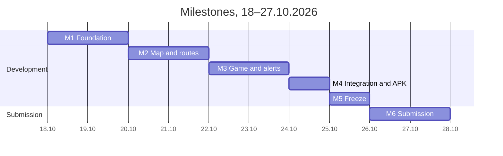

# Cool Łódź: mobile app specification

Oct 18, 2026 · @Mikita

> A copy of the specification kept in the repository: issues link to its sections. Two embedded diagrams of the original document have been replaced: the screen map with a link to Figma, the milestones with a diagram.

This is the complete specification package for the Cool Łódź app (part B of the brief), written for the executing agent: it is used to build the Figma mock-up, create the GitHub tasks and start development. The source of requirements is the brief «Cool Łódź: brief techniczny» v0.1 of 18.10.2026; where the specification disagrees with it, the specification wins. How the agent should work with this document is described in the last section.

## Assumptions

We have about 40 hours for the app between the two of us: 2 people × \~2.5 hours × 8 days (18–25.10); 26–27.10 are only for submission and the video. That is enough for the core if everything else is moved to kolejne kroki (next steps).

- **Owners:** MD — Mikita Dzeviatau, AH — Artem Hnap.
- **Data:** almost everything is real, so we do not add separate «dane symulowane» labels. The only thing that is mocked in the demo is the MPK discount codes: that is one line in the documentation, not a label in the UI.
- **Safety net:** the app has a demo mode with saved JSON for the two reference routes. If the module D API is unavailable, the app still shows routes.
- **Estimates** assume Claude Code is used. If a task takes more than 1.5 times its estimate, we cut it rather than push everything else back.
- **Internal deadline:** 25.10 freeze, 26.10 evening everything ready, 27.10 submission by 12:00.

## Product

Cool Łódź is an Android app that, in hot weather, plans walking routes across Łódź through shade, greenery and quiet streets, shows miejsca chłodu (cooling places) and water, and turns visiting them into a game. Competition: Hackathon Future Smart City 2026, Health Shift area, team Better Than Never.

**User's job:** get from point A to point B on a hot day spending as little time in the sun as possible, and know where to cool down and drink water.

**Target users:**

| Segment | What they need from the app |
| --- | --- |
| Seniors (65+) | Maximum shade, benches and rest spots on the route, large font, simple UI |
| Tourists | A shaded route between sights, air-conditioned places nearby |
| Parents with a pram | No stairs, shade, benches |
| Residents (work, study, leisure walks) | A trade-off between time and shade, heat alerts |
| Dog owners | Shade, greenery, water |

**UI language:** Polish (primary). English is out of scope, but all strings go into ARB files (`intl`) from the start so translation stays cheap.

**Scope (MoSCoW):**

| Feature | Priority | Comment |
| --- | --- | --- |
| Onboarding, e-mail sign-in, consents | M | No social sign-in |
| Comfort profile selection | M | 3 working profiles: Senior, Turysta, Domyślny. The other 5 from the brief are documentation only |
| Map with filters (shade, greenery, water, miejsca chłodu, air, quiet) | M | Layers from the module D API |
| Route planning A→B, date and time | M |  |
| Result: 3 variants (najkrótsza, zacieniona, kompromis) | M | Comparison by time, length, shade share |
| Miejsca chłodu: list, «otwarte teraz», «Prowadź tam» | M |  |
| Quest with QR codes and letters | M |  |
| Badges and points | M | At least 3 badges work in the demo |
| District and user leaderboard | M |  |
| Heat push alert and «heat mode» | M | A test push is enough for the demo |
| Settings, privacy, account deletion | M |  |
| «Best time to leave» slider on the route result | S | Shade is already computed in 30-minute intervals |
| Zgłoszenia (problem type + GPS, no photo) | S |  |
| Turn-by-turn navigation | out of scope | kolejne kroki |
| Post-walk route rating | out of scope | kolejne kroki |
| AI assistant | out of scope | kolejne kroki |
| Photos in zgłoszenia, group walks, referral code | out of scope | kolejne kroki |
| iOS | out of scope | Without Android, the website remains |

## Architecture and stack

The app does not compute shade itself: routes, map layers and places come from the shared module D API, while the account, game and leaderboard live in Firebase.

| Layer | Decision | Why |
| --- | --- | --- |
| Framework | Flutter (stable), Dart 3, Android only, minSdk 24 | Team experience from last year |
| State | Riverpod | Simple DI, easy to swap the API for demo mode |
| Navigation | go\_router, bottom bar with 4 tabs |  |
| Map | flutter\_map + vector/raster tiles from a provider with a free plan, OSM attribution | We do not use tile.openstreetmap.org in production |
| Map layers | GeoJSON from the module D API | Same source as the website |
| Account | Firebase Auth, e-mail and password |  |
| Game data | Cloud Firestore, region europe-central2 (Warsaw) | RODO (GDPR), data in the EU |
| Push | Firebase Cloud Messaging | Test alert sent from the Firebase console |
| QR | mobile\_scanner |  |
| Geolocation | geolocator, only while in use |  |
| HTTP | dio + json\_serializable | Models are built from the API contract |
| Local cache | shared\_preferences or hive | Last route and the list of miejsca chłodu without network |
| Cloud Functions | not used | Requires the Blaze plan; checks are done with Firestore rules |

**Demo mode.** The `ApiClient` class has two implementations: `RemoteApiClient` (the real module D) and `DemoApiClient` (JSON from `assets/demo/`). The switch is hidden in the settings (5 taps on the app version). If the remote API does not answer within 8 seconds, the app shows demo data and the banner «Brak połączenia z serwerem, pokazujemy ostatnie dane». This protects the presentation to the jury on 6.11.

**Project structure:**

```
lib/
  app/            router, theme, localisation
  core/           api (remote + demo), models, errors, geolocation
  features/
    auth/  onboarding/  profile/  map/  route/  cool_places/
    quest/  achievements/  leaderboard/  alerts/  reports/  settings/
  shared/         design system widgets
assets/demo/      JSON following the API contract
```

## Screen map

The screen map (16 screens, 4 tabs) is on the [Flow page in Figma](https://www.figma.com/design/U5IzePCuqa0gZlipjRQEOm/Cool-Lodz-App?node-id=1-5); the clickable prototype is on the [Screens](https://www.figma.com/design/U5IzePCuqa0gZlipjRQEOm/Cool-Lodz-App?node-id=1-4) page.

S07 «Wynik trasy» is highlighted — the app exists for its sake and the demo rests on it. Transitions between tabs (S08 → S07, S16 → S04) are labelled on the cards, not drawn as arrows.

## Screens

16 screens; in Figma each one is drawn in three states where they apply: data, loading, error or empty. Bottom bar: **Mapa**, **Chłód**, **Quest**, **Profil**. UI texts below are in Polish, as in the app.

### S01 Onboarding (M)

- 3 slides: «Idź w cieniu» (shaded routes), «Znajdź miejsce chłodu» (places and water), «Zbieraj litery» (quest and badges). Buttons «Dalej», «Pomiń».
- Shown once after installation.

### S02 Logowanie i rejestracja (M)

- Tabs «Zaloguj się» / «Załóż konto»: e-mail, password, nickname (on sign-up), link «Nie pamiętam hasła».
- Errors under the fields: wrong password, e-mail already taken, no network.
- The nickname is visible in the leaderboard; hint: «Nie podawaj imienia i nazwiska».

### S03 Zgody (M)

- Three toggles with an explanation: location (required for the quest), notifications, taking part in the ranking. Link to the privacy policy.
- Button «Akceptuję i dalej»; the Android system prompts appear after it.

### S04 Wybór profilu (M)

- Profile cards: Senior, Turysta, Domyślny (icon, 1-line description). The other profiles from the brief are inactive «Wkrótce» cards.
- Under the card, «Dostosuj»: 4 sliders (cień, czas, cisza, powietrze) from 0 to 100.
- The Senior profile turns on the large font (see "Design system").
- The same screen opens from Profil → «Mój profil komfortu».

### S05 Mapa (M, main screen)

- Map of Łódź, centred on the user, or on Śródmieście if location is off.
- At the top, the field «Dokąd idziesz?» → opens S06.
- A row of filter chips: Cień, Zieleń, Cisza, Powietrze, Woda, Miejsca chłodu. An active chip shows its layer; at most 2 fill layers (cień, zieleń, cisza, powietrze) at once, plus any point layers.
- «Ryzyko upałowe dziś» chip (low / moderate / high / very high): the rest of today's peak feels-like temperature from Open-Meteo on the UTCI heat-stress steps (26 / 32 / 38 °C, seniors 2 °C lower), never below the IMGW warning's level. The details show the feels-like now and at the peak, the hottest hours, UV (WHO category), an asphalt estimate, advice for the profile and «Źle się czujesz? Sprawdź objawy». With «Chodzę z psem» (Profil) a paw icon and warning appear from 45 °C asphalt (52 °C: too hot), also on S07.
- Shade layer: semi-transparent blue fill; above the map a time label «Cień o 14:30» with the weather icon and a button to change the time. The time is picked like an alarm clock: day chips (today + 7 days), hour and minute wheels (5-minute steps), the weather of the chosen time (sky icon, temperature, wind, heat, rain chance) and an hourly strip with icons.
- Points: miejsca chłodu (snowflake), water (drop), benches (only at zoom ≥ 17).
- If a heat alert is active — a banner at the top «Ostrzeżenie przed upałem, stopień 2» (colour by level); tapping it opens S14.
- Tapping a point → bottom sheet S08.
- States: no location (button «Włącz lokalizację»), no network (demo banner).

### S06 Planowanie trasy (M)

- Fields «Skąd» (default «Moja lokalizacja») and «Dokąd», search by address and place, swap button.
- Departure date and time («Teraz» by default).
- Current profile as a chip; tapping it → S04.
- Quick options: two reference routes (Manufaktura → Piotrkowska, Plac Wolności → Piotrkowska) for the demo.
- Button «Pokaż trasy».

### S07 Wynik trasy (M)

- Map with three lines; the selected one is bright, the others grey. On the selected line, sunny segments are orange and shaded ones blue.
- Bottom sheet with three cards: **Najkrótsza**, **Zacieniona**, **Kompromis**. On a card: time (min), length (km), shade share (%, large, with a bar), «+4 min względem najkrótszej», icons for stops on the way (miejsca chłodu, water).
- Kompromis is selected by default; for the Senior profile — Zacieniona.
- (S) Slider «Najlepsza pora wyjścia»: hours 8:00–20:00, with a mini chart of the selected variant's shade share below it.
- «Udostępnij trasę» on S07: from, to, departure, arrival, minutes, shade share and a Google Maps walking link through the share sheet.
- «Kiedy najlepiej iść?» on S06: up to three departures (an hour apart) ranked by shade on the walk, the weather (heat over 26 °C, rain, storm, wind, darkness count against) and opening hours (the destination when it is a cool place, open cool places on the way). A tap sets the departure. The departure time uses the same alarm-style picker as the shade.
- Button «Prowadź» opens the route in Google Maps (navigation is out of scope); button «Zapisz».
- States: loading (card skeleton), route not found, outside the shade calculation area («Dla tego obszaru cień jest przybliżony»).

### S08 Szczegóły miejsca (M, bottom sheet)

- Name, type, address, opening hours, status «Otwarte teraz / Zamknięte, otwarcie o 10:00».
- Amenity icons: klimatyzacja, woda, toaleta, dostępne dla wózków.
- If the place is part of the quest — badge «Litera do zdobycia».
- Buttons «Prowadź tam» (→ S07 with this place as B) and «Zgłoś problem» (→ S15).

### S09 Miejsca chłodu (M, Chłód tab)

- Toggle «Lista / Mapa». The list is sorted by distance.
- Filter chips: Otwarte teraz, Z wodą, Dostępne, W queście.
- List item: name, type, distance, today's hours, status.
- Empty: «Brak otwartych miejsc w pobliżu» + button «Pokaż wszystkie».

### S10 Quest (M, Quest tab)

- Quest title «Chłodne hasło», a grid of letters: found ones revealed, missing ones as empty tiles.
- Progress «4 z 7 liter», list of quest places with status (odwiedzone / do odwiedzenia), a «Prowadź tam» button for each.
- Large button «Skanuj kod QR» → S11.
- After all letters — a password (hasło) input, then the reward screen: discount code and a text about MPK.
- In heat mode, a strip at the top: «Dziś odwiedzaj miejsca rano lub wieczorem».
- Segments inside the tab: Quest, Odznaki (S12), Ranking (S13).

### S11 Skaner QR (M)

- Full-screen camera with a frame, hint «Zeskanuj kod przy wejściu».
- Success: letter reveal animation, «+50 pkt».
- Errors: «Jesteś za daleko od miejsca» (> 150 m), «Ten kod już dziś zeskanowałeś», «Kod nieważny».
- No camera permission: explanation and button «Otwórz ustawienia».

### S12 Odznaki i punkty (M)

- Badge grid, 3 per row: earned ones in colour, the rest grey with the condition to earn them.
- At the top, the points total and the last 10 awards (what, when, how many).
- When a badge is earned — a modal with confetti.

### S13 Ranking (M)

- Toggle «Dzielnice / Użytkownicy», period «Ten tydzień / Całe lato».
- Row: position, district name or nickname, points. The user's own row is highlighted and pinned to the bottom if it is not on screen.

### S14 Alert upałowy i tryb upału (M)

- Push: «Ostrzeżenie przed upałem 2. stopnia w Łodzi do 20:00. Zobacz trasy w cieniu».
- Alert screen: level, period, source (IMGW), 3 short recommendations, link to the official zalecenia (guidance), button «Pokaż miejsca chłodu».
- Heat mode turns on at level 3: quest tasks in the sun are hidden, miejsca chłodu get priority on the map, banner on S05 and S10.

### S15 Zgłoszenie (S)

- Type: brak ławki, brak poidełka, brak cienia, inne. GPS position on a mini map (can be moved), comment up to 200 characters.
- After sending: «Dziękujemy! +20 pkt po zatwierdzeniu».

### S16 Profil i ustawienia (M, Profil tab)

- Header: nickname, district (choice of 5), points total.
- Items: Mój profil komfortu, Powiadomienia, Zgody i prywatność, Polityka prywatności, O aplikacji i źródła danych, Wyloguj, Usuń konto.
- «Usuń konto»: confirmation by entering the password; deletes the user and all their documents.
- «O aplikacji»: version (5 taps → demo mode switch), data sources and OSM attribution.
- «Objawy przegrzania» (Profil, S14, heat risk details): five yes/no questions; a heatstroke red flag (confusion, fainting, hot dry skin) → «Zadzwoń 112» with first aid; heat exhaustion signs → the nearest open cool place and 112 if no improvement in 30 min. Not a diagnosis.
- «Alarm upałowy» (opt-in): while it is hot (IMGW heat warning, or ≥ 28 °C / feels like ≥ 30 °C from Open-Meteo; «Tylko w upał» can be switched off), the phone watches its location. After walking somewhere (≥ 100 m in the 10 min before) and staying within 40 m for the set time (3–15 min, default 7, Senior 5), it asks «Wszystko w porządku?» on a full-screen alarm over the lock screen. No answer: after 30 s the siren plays at half volume (alarm stream, works in silent mode), after another 30 s at full volume with the flashlight blinking, and an SMS with the location goes from the user's own SIM to up to 3 trusted contacts. The alarm screen then tells passers-by what to do in heatstroke and has a big «Zadzwoń 112» button. No checks at home or at cool places; «OK» silences the same stop for 30 min; «Potrzebuję pomocy» goes straight to the full alarm. The app never calls 112 by itself. «Przetestuj alarm» runs the whole check in 5-second steps without the SMS.

## Design system

Based on Material 3 with a custom "cool versus heat" palette: blue-teal means shade and safety, orange means sun and heat. Light theme only; dark theme is out of scope. Base frame in Figma: Android 360 × 800 dp.

**Colours (tokens):**

| Token | HEX | Where it is used |
| --- | --- | --- |
| `primary` / cień | #0E6E8C | Buttons, active chips, shade on the route, shade layer (35% opacity) |
| `primaryContainer` | #CDEFF7 | Background of the selected card, strips |
| `green` / zieleń | #2E8B57 | Greenery layer (30%), parks, «Łowca parków» badges |
| `sun` / słońce | #F28C28 | Sunny segments, heat icons. Fills and lines only, never text on white |
| `water` | #2F80ED | Water points |
| `cool` | #5BC0EB | Miejsca chłodu points |
| `heat1` | #F2C230 | Level 1 alert |
| `heat2` | #F28C28 | Level 2 alert |
| `heat3` | #D7263D | Level 3 alert, heat mode |
| `background` | #F7FAFB | Screen background |
| `surface` | #FFFFFF | Cards, sheets |
| `surfaceVariant` | #EAF1F3 | Inactive chips, dividers |
| `onSurface` | #12232B | Primary text |
| `onSurfaceVariant` | #4A5D66 | Secondary text |
| `muted` | #9AA9B0 | Unselected routes, locked badges |
| `error` | #B3261E | Errors |
| `success` | #1E8E3E | Success, «Otwarte teraz» |

The air quality layer uses the official GIOŚ index colour scale (take it from powietrze.gios.gov.pl); the quiet layer uses a purple heat map.

**Font:** Inter (Google Fonts, full support for Polish letters).

| Style | Size / line height, sp | Weight |
| --- | --- | --- |
| Display | 32 / 40 | Bold — shade share on the route card |
| Title L | 24 / 32 | SemiBold — screen titles |
| Title M | 20 / 28 | SemiBold — sheet and card titles |
| Body | 16 / 24 | Regular |
| Body S | 14 / 20 | Regular — secondary text |
| Label | 12 / 16 | Medium — chips, captions |

**Spacing and shapes:** 4 dp grid (4, 8, 12, 16, 24, 32); screen margins 16 dp; radii: chips 8, cards 12, sheets 20 (top corners); buttons 52 dp high, radius 12; touch target at least 48 × 48 dp.

**Senior mode** (turned on by the profile, can also be set separately in settings): all font styles × 1.25, buttons 60 dp, fewer elements on screen (on S07 one card is fully visible, the others scroll), labels on all icons.

**Route lines:** selected variant 6 dp, shaded segments `primary`, sunny `sun`; unselected 4 dp `muted`.

**Icons:** Material Symbols Rounded. 3 custom icons: miejsce chłodu (snowflake in a house), poidełko (drop with a tap), quest letter. The logo is a placeholder; the final one is made by the team in Gemini.

**Components for Figma (with variants):**

- Button: primary, secondary, text; regular and Senior.
- FilterChip: off, on; with a layer icon.
- SearchField «Dokąd idziesz?».
- RouteVariantCard: najkrótsza, zacieniona, kompromis; selected and not; with a ShadeBar.
- ShadeBar: horizontal shade share bar with the number in %.
- HeatBanner: levels 1, 2, 3.
- PlaceListItem and PlaceSheet: open, closed, in quest.
- LetterTile: found, empty.
- BadgeTile: earned, locked.
- LeaderboardRow: regular, own.
- BottomNav: 4 tabs, active and not.
- EmptyState, ErrorState, Skeleton, Toast, badge modal.

**Accessibility:** text contrast at least WCAG AA (4.5:1); colour is never the only carrier of meaning (the shade colour always comes with a number in %); labels for TalkBack; the app respects the system font size.

**Tone of copy:** informal «ty», short and calm, no scaremongering and no medical promises. In «O aplikacji» the line: «Aplikacja nie jest wyrobem medycznym. W razie złego samopoczucia dzwoń 112».

## Gamification

The game rewards walks in the shade and visits to miejsca chłodu in the morning and evening, not going out in the worst heat. The numbers below are starting values; the team may change them, and they live in a single config file, `game_config.dart`.

**Quest «Chłodne hasło»:**

1. 7 quest places (from the list of miejsca chłodu, see "Data"), each with a QR code and one letter. Example password (hasło): CHŁODNO.
2. The QR contains the link `coollodz://quest/{placeId}?c={kod}`.
3. A scan counts if: the code matches the place's code in Firestore (checked by the security rules), the user is no further than 150 m from the place (checked in the app), and it is the first scan of this place today (document id `{uid}_{placeId}_{yyyyMMdd}`, overwriting is forbidden by the rules).
4. After 7 letters the user enters the hasło and gets a discount code. In the demo the code is a mock; real integration with MigAppka MPK is in kolejne kroki.
5. Place codes can be changed manually in Firestore (e.g. once a week) so that an old photo of a QR code stops working.

**Points:**

| Action | Points | Limit |
| --- | --- | --- |
| QR scan at a miejsce chłodu | 50 | Once a day per place |
| Route with shade share ≥ 60% | 10 | At most 5 a day; in heat mode 0 if departing between 11:00 and 17:00 |
| Quest hasło solved | 200 | Once |
| Badge earned | 30 | Once per badge |
| Zgłoszenie approved (S) | 20 | Approved manually in the Firebase console |

**Badges** (the first four must work in the demo):

| Badge | Condition |
| --- | --- |
| Pierwszy krok | First route planned |
| Cienista dziesiątka | 10 routes with shade share ≥ 60% |
| Strażnik chłodu | 5 different miejsca chłodu scanned |
| Ranny ptaszek | Route departing 6:00–10:00 on a heat alert day |
| Wieczorny spacerowicz | Route departing 19:00–22:00 on a heat alert day |
| Łowca parków | 5 routes ending in a park |
| Pomocnik miasta (S) | 3 approved zgłoszenia |

Ambasador (referral code) and Wspólny spacer are kolejne kroki.

**Leaderboard:** 5 districts (Bałuty, Górna, Polesie, Śródmieście, Widzew; to be confirmed, see "Open questions"). The user picks a district in the profile; their points count towards both the personal leaderboard and the district leaderboard. Periods: current week (ISO week) and the whole summer. Only the nickname is visible in the leaderboard.

**Safety rule (level 3 alert):**

- tasks and points for routes departing 11:00–17:00 are disabled;
- the quest shows the hint «Odwiedzaj miejsca rano lub wieczorem»; the miejsca chłodu themselves stay available as shelter;
- on S05, S10 and S14 a banner with a link to the official zalecenia.

**Known limitation:** without Cloud Functions the client awards points, and the Firestore rules only limit the size of the increment. This is acceptable for the competition; server-side validation is in kolejne kroki.

### Map modes (added 22.10)

- «Ławki»: its own point layer (on from the start for seniors), pins from zoom 16; below that a hint zooms in.
- «Cisza» reads like a traffic light: red bands along loud roads, green where it is quiet, darker green very quiet (parks, far from roads), with a three-line legend.
- Trees: with «Cień» on, from zoom 16 the tree crowns that cast the shadows are drawn in green.
- «Nocą» (for tourists): where people are in the evening — streets by night venues within 40 m (bars and clubs count double): busiest, lively, lit; bars, pubs and clubs as dots.
- «Zima»: the snow clearing order estimated from the street category (first main streets and bus/tram routes, then district streets and pedestrian precincts, residential last). Łódź does not publish the plan as open data.
- «Toalety»: public toilets (free or paid) from OSM.
- One street mode at a time; they do not count towards the 2 fills.

### Shop (added 22.10)

- «Sklep z nagrodami» (Quest → Odznaki → «Wymień punkty w sklepie»): points buy MPK tickets (20 min 300, 60 min 500, 24 h 1000), museum entries (Palmiarnia 400, Centralne Muzeum Włókiennictwa 600, Muzeum Sztuki 800) and culture discounts (EC1 Planetarium 700, Filharmonia 1000, Teatr Jaracza 1200). Spending adds to `users/{uid}.spent` (only grows, never above `points`), so the total and the ranking keep the points; the code goes to `users/{uid}/redemptions` in the same batch. Codes are demo codes until there are agreements with the partners.
- The quest password gives 500 points (written as 200 + 200 + 100).
- Onboarding has a slide per feature (shade map, routes, cool places, heat risk, heat alarm, quest, shop) and opens again from Profil («Jak działa aplikacja»).

### Weekly challenge and impact (added 22.10)

- «Wyzwanie tygodnia» on S10: one goal per ISO week in rotation — 3 shaded routes, 2 quest places, 5 km, 2 walks before 10:00 or from 19:00, 2 routes past a water point — counted from `users/{uid}/routes` and the scan entries. Completing it pays +50 once (`pointsLog` type `challenge`, `refId` = the week). `config/game.challenge` (a kind name) picks one for a demo; demo mode needs 1.
- «Twój wpływ» on S12: walks, distance, minutes in shade, sun avoided compared with the shortest walk at the same time, water points on the way, quest places and CO₂ a car would have emitted (0.17 kg/km). Routes store `duration_s`, `shortestSunShare` and `waterStops` for it.

## Data

The app gets geodata (routes, places, layers, alerts) from the module D API, and the account, game and leaderboard from Firestore. The app does not use the `/v1/quests` and `/v1/leaderboard` endpoints from the brief: the game lives in Firestore.

**Module D endpoints (contract from section 6 of the brief):**

| Endpoint | Screens | Note |
| --- | --- | --- |
| `POST /v1/routes` | S06, S07 | Input: `from`, `to`, `datetime`, `profile` (id + weights), `filters`. Output: 3 variants |
| `GET /v1/places?type=cool,water,bench&bbox=` | S05, S08, S09, S10 | Needs the fields `hours`, `amenities`, `accessible`, `questPlace` |
| `GET /v1/alerts?lat&lon` | S05, S14 |  |
| `GET /v1/air?bbox` | S05 (Powietrze layer) |  |
| `GET /v1/layers/{shade,green,noise}?bbox&datetime` | S05 | **This new endpoint is not in the brief**; it must be requested from module D (GeoJSON or tile URL) |
| `POST /v1/reports` | S15 | Alternative: write directly to Firestore `reports` |

Example of one route variant (the structure is fixed in `core/models`):

```json
{
  "variant": "shaded",
  "geometry": {"type": "LineString", "coordinates": [[19.4466, 51.7794], [19.4570, 51.7720]]},
  "segments": [{"from": 0, "to": 12, "sunShare": 0.15}],
  "distance_m": 2140,
  "duration_s": 1680,
  "sunShare": 0.28,
  "extraTimeVsShortest_s": 240,
  "stops": [{"placeId": "cool-017", "type": "cool"}],
  "sunShareByHour": {"08:00": 0.12, "08:30": 0.15}
}
```

The `segments` field is needed to colour the line "shade / sun" on S07, and `sunShareByHour` for the best-time slider. Both fields must be agreed with module D.

**Firestore (region europe-central2):**

| Collection | Fields | Access |
| --- | --- | --- |
| `users/{uid}` | `nickname`, `district`, `profile` {`id`, `weights`, `seniorMode`}, `consents` {`location`, `push`, `ranking`, `acceptedAt`}, `points`, `badges[]`, `fcmToken`, `createdAt` | Read and write by the owner only; `points` grows by at most 200 per write |
| `users/{uid}/pointsLog/{id}` | `type`, `points`, `refId`, `createdAt` | Owner only, create only |
| `users/{uid}/routes/{id}` | `from`, `to`, `departAt`, `variant`, `sunShare`, `distance_m`, `endPlaceType`, `createdAt` | Owner only; needed for badges |
| `visits/{uid_placeId_yyyyMMdd}` | `uid`, `placeId`, `code`, `lat`, `lon`, `createdAt` | Create only; `code` must match `questCodes/{placeId}` |
| `questPlaces/{placeId}` | `name`, `letter`, `order`, `lat`, `lon` | Readable by all signed-in users |
| `questCodes/{placeId}` | `code` | Not read by the client; used only in the rules |
| `districts/{id}` and `districts/{id}/weeks/{yyyy-Www}` | `name`, `points` | Readable by all; increment at most 200 per write |
| `reports/{id}` | `uid`, `type`, `lat`, `lon`, `comment`, `status` (new, approved, rejected), `createdAt` | Created by the author; only an admin changes the status |
| `config/game` | `heatOverride` (0–3), `activeQuestId` | Readable by all; lets us turn on heat mode for the demo |

User leaderboard: query `users` with `consents.ranking == true`, ordered by `points`, top 50 (needs a composite index).

**Demo JSON** (`assets/demo/`), all following the API contract:

- `routes_manufaktura_piotrkowska.json`, `routes_plac_wolnosci_piotrkowska.json` — 3 variants each, for several departure times;
- `places_cool.json` (hand-collected list, see the backlog), `places_water.json`, `places_bench.json`;
- `alerts_none.json`, `alerts_level2.json`, `alerts_level3.json`;
- `layer_shade_1430.geojson`, `layer_green.geojson`, `layer_noise.geojson`, `air.json` — for Śródmieście.

## Non-functional requirements

| Area | Requirement |
| --- | --- |
| Privacy (RODO) | Minimal data: e-mail, nickname, district, profile settings. No health data: the profile is a set of route preferences. Location only while in use; the walk track is not stored. Deleting the account deletes all of the user's documents. The privacy policy is reachable from S03 and S16 |
| Keys | The app contains no keys for external providers. The Firebase configuration is a regular `google-services.json` |
| Performance | Cold start under 3 s on a mid-range Android phone; a route response is shown within 5 s, otherwise a skeleton, and after 8 s fallback to demo data |
| Offline | The last route and the list of miejsca chłodu are available without network |
| Devices | Android 7.0+ (minSdk 24), screens from 360 dp wide, portrait orientation only |
| Build | Release APK signed with the team key (the key is not in the repository), `versionName` 1.0.0. Distribution: GitHub Releases + a link on the website `/pobierz` and in the submission |
| Quality | `flutter analyze` with no errors; unit tests for the game rules (points, badges, heat mode) and for parsing the API models |
| Licences | OpenStreetMap attribution on the map and in «O aplikacji»; the list of data sources is there too |
| Use of AI | We keep a short log of which tasks were done with Claude Code. It goes to Mikita Kutsenka for the documentation (required by the rules) |

## Milestones



A milestone is reached when the condition below is met; if not, the next day we cut S tasks first. The final is on 6.11 at 10:00, and by then the app must also work in demo mode.

- **M1 Foundation (19.10):** the app builds, sign-in works, demo JSON and the list of miejsca chłodu are in the repository, the Figma mock-up has been reviewed.
- **M2 Map and routes (21.10):** on demo data the flow S05 → S06 → S07 with three variants works; the first real route has arrived from module D.
- **M3 Game and alerts (23.10):** a QR scan reveals a letter, 4 badges unlock, push arrives, heat mode is turned on from `config/game`.
- **M4 Integration and APK (24.10):** reference routes from the real API, signed APK in a GitHub Release.
- **M5 Freeze (25.10):** the DoD checklist passed on two phones, screenshots handed in; after this only critical bug fixes.
- **M6 Submission (26–27.10):** video and materials are with Mikita K., the ChallengeRocket submission sent on 27.10 by 12:00 (formal deadline 23:59).

## Task backlog (GitHub issues)

The M-priority tasks add up to about 46 hours against a budget of about 45 (2 people × 2.5 h × 9 days), so there is no slack. That is why S tasks and the video are done only if we are ahead of schedule; if on 22.10 we are more than 3 hours behind, we first drop the leaderboard periods (keeping only «całe lato»), then the district leaderboard.

One row = one issue. Issue title = «ID: task», description = link to the specification section + the "Done when" column as a checklist.

| ID | Task | Owner | Milestone | H | Labels | Done when |
| --- | --- | --- | --- | --- | --- | --- |
| APP-00 | Figma mock-up based on the "Screens" and "Design system" sections | agent, review MD+AH | M1 | — | design | 16 screens, components and tokens in Figma; the team has left comments |
| APP-01 | Flutter skeleton: structure, go\_router, Riverpod, theme from tokens, PL localisation | MD | M1 | 1.5 | infra, prio:M | The app launches, 4 tabs switch, colours and font come from tokens |
| APP-02 | Firebase: project in europe-central2, e-mail Auth, Firestore, FCM | MD | M1 | 1.5 | infra, prio:M | Sign-up creates a user; a test push reaches the phone |
| APP-03 | API models, RemoteApiClient, DemoApiClient, switch and 8 s fallback | AH | M1 | 2.5 | infra, area:api, prio:M | Both implementations pass a unit test on the same JSON |
| APP-04 | Demo JSON: 2 reference routes, alerts, Śródmieście layers | AH | M1 | 1 | data, prio:M | Files in `assets/demo/` are valid against the models |
| APP-05 | Hand-made list of 15–20 miejsca chłodu in Łódź: address, summer hours, amenities, source; 7 of them for the quest | AH | M1 | 3 | data, prio:M | JSON handed to module D and stored in demo; every place has a link to the source of its hours |
| APP-06 | Basic design system components (list in "Design system") | AH | M2 | 1.5 | ui, prio:M | Components in `shared/`, a showcase page in the debug build |
| APP-07 | S01–S03: onboarding, sign-in and sign-up, consents | MD | M1 | 2 | area:auth, prio:M | A new user gets through to the map; sign-in errors are shown |
| APP-08 | S04: profile selection, sliders, Senior mode | MD | M2 | 1.5 | area:profile, prio:M | The profile is saved in `users/{uid}`; Senior scales the font by 1.25 |
| APP-09 | S05: map, filter chips, layers, points, alert banner | AH | M2 | 3 | area:map, prio:M | All 6 filters toggle layers on demo data |
| APP-10 | S06: route planning, search, departure time, quick routes | MD | M2 | 1.5 | area:route, prio:M | The request is sent with the profile and time |
| APP-11 | S07: 3 variants, shade/sun colouring, comparison, «Prowadź» | MD | M2 | 2.5 | area:route, prio:M | A reference route shows 3 variants; changing the profile changes the default variant |
| APP-12 | S08 place sheet and S09 list of miejsca chłodu with filters | AH | M2 | 2 | area:places, prio:M | «Otwarte teraz» is computed from the hours; «Prowadź tam» opens S07 |
| APP-13 | Firestore schema, security rules, indexes, `config/game` | AH | M3 | 1.5 | infra, area:game, prio:M | Rules test: a repeat scan on the same day and someone else's document are rejected |
| APP-14 | S10 quest and S11 QR scanner with checks | MD | M3 | 3 | area:game, prio:M | A scan reveals a letter and gives 50 points; a repeat scan and a scan from more than 150 m away are rejected |
| APP-15 | QR code generator for the 7 quest places (printable PDF) | AH | M3 | 0.5 | data, area:game, prio:M | 7 codes printed for the video and the demo |
| APP-16 | Points and badges engine (`game_config.dart`, unit tests) and S12 | AH | M3 | 2.5 | area:game, prio:M | In the demo Pierwszy krok, Cienista dziesiątka, Strażnik chłodu, Ranny ptaszek unlock |
| APP-17 | S13 user and district leaderboard, week and summer | AH | M3 | 1.5 | area:game, prio:M | Own row highlighted; without ranking consent the user is not in the list |
| APP-18 | Push alert, S14, heat mode via `heatOverride` | MD | M3 | 2 | area:alerts, prio:M | A test push opens S14; level 3 disables points for routes 11–17 |
| APP-19 | S16 profile, settings, account deletion, «O aplikacji», demo switch | MD | M4 | 1.5 | area:settings, prio:M | Account deletion erases the user and their documents |
| APP-20 | Integration with the real module D API | AH + MD | M4 | 3 | area:api, prio:M | Both reference routes come from the real API; when it is down, demo works |
| APP-21 | Release APK, signing, GitHub Release, link for `/pobierz` | MD | M4 | 1 | infra, prio:M | The APK installs on a clean phone without errors |
| APP-22 | «Najlepsza pora wyjścia» slider on S07 | AH | M4 | 1.5 | area:route, prio:S | The slider changes the shade share on the cards |
| APP-23 | S15 zgłoszenia (type, GPS, comment) | AH | M4 | 1.5 | area:reports, prio:S | A record appears in `reports` with status new |
| APP-24 | Testing on real phones, fixes, freeze | MD + AH | M5 | 4 | qa, prio:M | The DoD checklist from the brief (B10) passed |
| APP-25 | Screenshots for the documentation (list from B10) | AH | M5 | 1 | docs, prio:M | 9 screenshots in the shared folder |
| APP-26 | List of limitations and AI usage log for Mikita K. | MD | M5 | 0.5 | docs, prio:M | Sent to Mikita Kutsenka |
| APP-27 | Video (if confirmed as the app team's job) | AH | M6 | 3 | docs, prio:S | Video in the submission |
| APP-28 | Uploading the submission to ChallengeRocket | MD | M6 | 0.5 | docs, prio:M | Submission sent on 27.10 by 12:00 |

## Dependencies on other teams

The biggest risk is a late real API: without the first real route by 21.10, the integration on 24.10 will not have time to find mismatches with the contract.

| What the app needs | From whom | Deadline | If not ready |
| --- | --- | --- | --- |
| Decision on who runs module D (question 1 of the brief) | Website team, Mikita K. | 19.10 | Escalate to the team's shared chat |
| Example JSON following the contract (routes, places, alerts) in the repository | Module D | 19.10 | The app writes them itself (APP-04) and gives them to module D as the reference |
| Fields `segments` and `sunShareByHour` in the `/v1/routes` response | Module D | agree by 20.10 | Route drawn in a single colour, time slider dropped |
| New endpoint `/v1/layers/*` for shade, greenery and noise layers | Module D | 21.10 | Layers come from static GeoJSON in demo |
| First real route (one reference route) | Module D | 21.10 | Integration on demo only; say so honestly in the documentation |
| All app endpoints on a public address | Module D | 23.10 | Same |
| `/pobierz` page with the APK link and QR | Website | 24.10 | Link to the GitHub Release in the submission |
| List of miejsca chłodu loaded into `/v1/places` | Module D (data from AH, APP-05) | 22.10 | Places from the demo JSON |

## Out of scope (next steps)

These features are described in the documentation as future development; they are not in the code:

- in-app turn-by-turn navigation (for now the route is handed over to Google Maps);
- post-walk route rating;
- natural-language AI assistant;
- photos in zgłoszenia, group walks, referral code and the Ambasador and Wspólny spacer badges;
- 5 of the 8 comfort profiles (dog, pram, commute, active, sensitivity to noise and smog) as separate cards; their weights are already available through the sliders;
- sign-in with Google and other external accounts;
- real MPK codes in MigAppka (requires an agreement with MPK);
- server-side validation of points (Cloud Functions);
- iOS, English language, dark theme.

## Demo scenario (3 minutes)

One continuous story that we use to check readiness, record the video and present to the jury on 6.11. Before the presentation, set `heatOverride = 2` in `config/game`.

1. The push «Ostrzeżenie przed upałem 2. stopnia» arrives → S14 → «Pokaż miejsca chłodu».
2. S05: Cień and Miejsca chłodu are on in the map; you can see the shade lying on Piotrkowska at 14:30.
3. S06: quick route Manufaktura → Piotrkowska, Senior profile.
4. S07: three variants; Zacieniona gives, for example, 72% shade versus 31% for Najkrótsza for +4 minutes (real numbers come from the module D test). The time slider shows there is more shade at 18:00.
5. A miejsce chłodu on the route → S08 → «Prowadź tam».
6. S11: QR scan at the entrance, a letter is revealed, +50 points, the Strażnik chłodu badge pops up (for the demo the threshold can be lowered in `game_config`).
7. S13: the Śródmieście district climbs the leaderboard.
8. Switch to the website: the Cool Łódź City panel shows the same miejsca chłodu and the gaps in shade (the website team's part).

## Open questions

- [ ] Who runs module D and who is responsible for the `/v1/layers/*` endpoint — Mikita K., by 19.10.
- [ ] Agree the `segments` and `sunShareByHour` fields in `/v1/routes` — MD with module D, by 20.10.
- [ ] Confirm the 5 districts for the leaderboard (Bałuty, Górna, Polesie, Śródmieście, Widzew) — Mikita K., by 20.10.
- [ ] Is the video made by the app team or someone else — Mikita K., by 20.10.
- [ ] Does the website read the leaderboard from Firestore for the public preview, or through module D — MD with the website team, by 22.10.
- [ ] Map tile provider with a free plan and its limits — AH, by 20.10.
- [ ] Quest hasło and the 7 quest places — AH, together with APP-05.

## Instructions for the agent

The agent does three things in order: the Figma file, the GitHub setup, the repository skeleton. The agent does not invent decisions that are not in the specification; it records them in an issue labelled `question`.

**1. Figma** (a separate file «Cool Łódź — App», pages in this order):

1. Cover — title, team, date, link to this specification.
2. Tokens — colours and text styles from "Design system" as Figma Variables and Text Styles (Default and Senior modes for sizes).
3. Components — all components from the list, with Variants and Auto Layout.
4. Screens — S01–S16 in 360 × 800 frames, frame name = code and title (`S07 Wynik trasy`); loading, empty and error states as neighbouring frames `S07 / loading`. For S04, S07, S10 also a Senior version.
5. Flow — prototype links following the "Screen map" and a clickable path for the demo scenario.

Data in the mock-ups is real: Łódź streets, places from APP-05 (until it is ready — Biblioteka Miejska, EC1, Manufaktura, Ogród Botaniczny), route numbers in a plausible range. No lorem ipsum.

**2. GitHub:**

- Repository `cool-lodz-app` (or an `app/` folder in a shared monorepo, if the team decides so).
- Labels: `prio:M`, `prio:S`, `infra`, `data`, `ui`, `design`, `qa`, `docs`, `question`, `area:auth`, `area:profile`, `area:map`, `area:route`, `area:places`, `area:game`, `area:alerts`, `area:settings`, `area:reports`, `area:api`.
- Milestones with the dates from the "Milestones" section.
- Issues APP-00…APP-28 from the backlog: title «ID: task», assignee from the "Owner" column (check GitHub logins with the team), body = link to the specification section, estimate in hours, checklist from "Done when". Dependencies from the "Dependencies on other teams" section become separate issues labelled `question` for the other teams.
- Project (board): columns Backlog, To do, In progress, Review, Done; fields Estimate (hours) and Milestone.

**3. Repository skeleton:**

- `flutter create --org pl.betterthannever --project-name cool_lodz --platforms android`.
- Folder structure from "Architecture and stack", dependencies in `pubspec.yaml` (go\_router, flutter\_riverpod, flutter\_map, dio, json\_serializable, firebase\_core, firebase\_auth, cloud\_firestore, firebase\_messaging, mobile\_scanner, geolocator, intl, shared\_preferences).
- Theme from the design system tokens in `app/theme.dart`, a `game_config.dart` file with the values from "Gamification".
- `firestore.rules` and `firestore.indexes.json` following the "Data" section.
- GitHub Actions: `flutter analyze` and `flutter test` on every PR.
- Branches: `main` is protected, work happens in `feat/APP-xx-…`, PRs link to their issue; a PR template with a checklist (screenshot, test, issue link).
- README: how to run, how to turn on demo mode, where the specification is.
- Do not commit `google-services.json` or the APK signing key to the repository (`.gitignore`).
